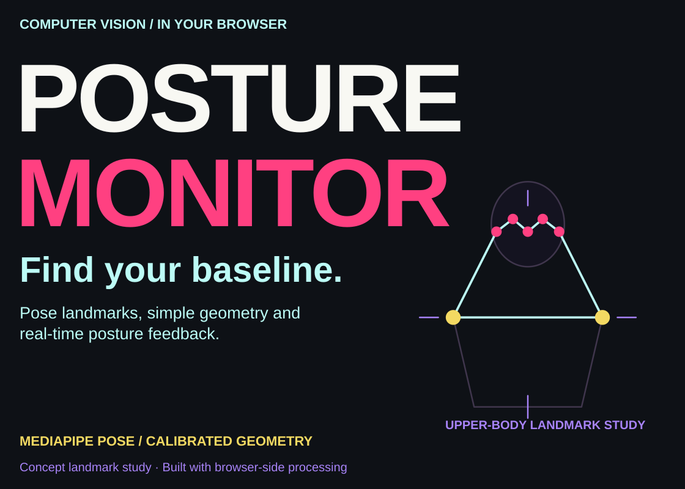
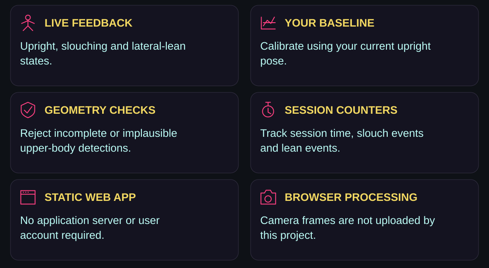
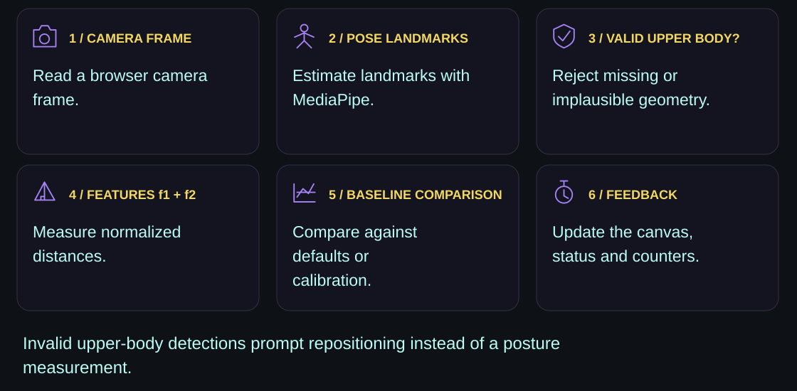
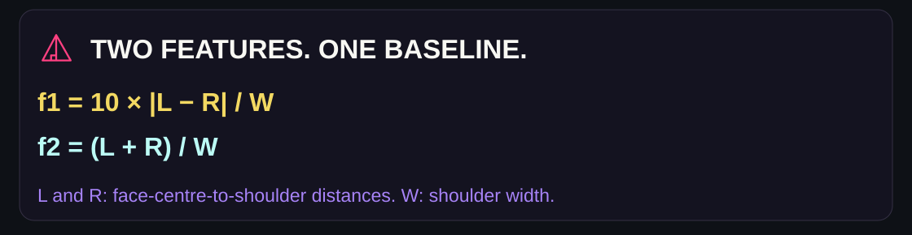
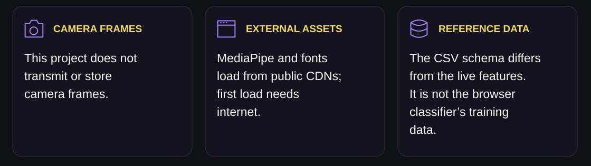
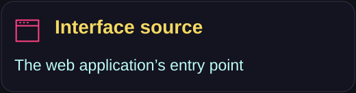
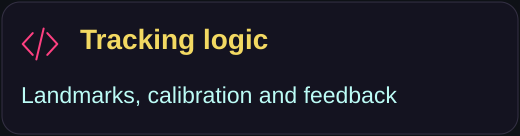
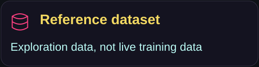
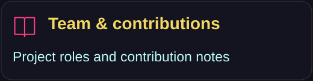
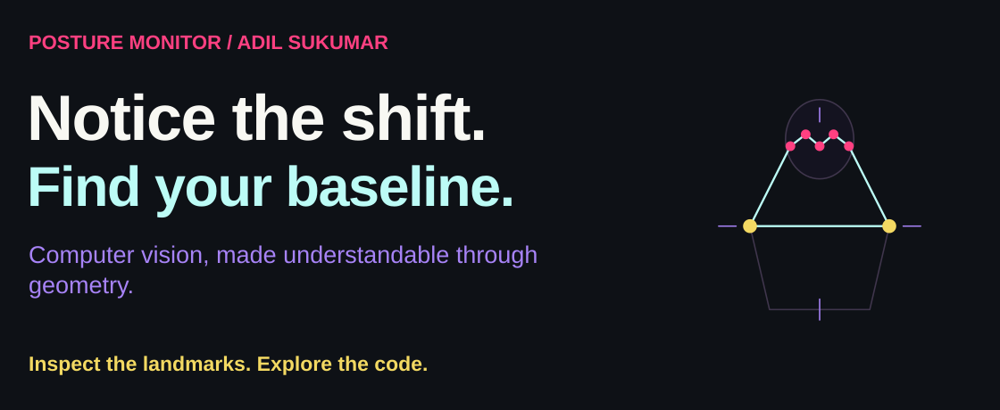

<p><picture><source media="(max-width: 600px)" srcset="assets/readme/hero-mobile.svg"/></picture></p>

<p align="center"><a href="#features">Features</a> · <a href="#how-it-works">Geometry</a> · <a href="#run-locally">Run locally</a> · <a href="#privacy-and-limitations">Privacy & limitations</a> · <a href="#explore-the-project">Explore</a></p>

Posture Monitor is a static web application that uses MediaPipe Pose to estimate upper-body landmarks and provide real-time posture feedback. Camera frames are processed in the browser and are not uploaded by this project.

**This is a heuristic posture aid, not a medical device or diagnostic tool.**

<a id="features"></a>

##  Features

<p><picture><source media="(max-width: 600px)" srcset="assets/readme/capabilities-mobile.svg"/></picture></p>

<a id="how-it-works"></a>

##  How it works

<p><picture><source media="(max-width: 600px)" srcset="assets/readme/pipeline-mobile.svg"/></picture></p>

<p><picture><source media="(max-width: 600px)" srcset="assets/readme/geometry-mobile.svg"/></picture></p>

The browser computes two normalized geometric features:

- `f1` measures left-right asymmetry between face-to-shoulder distances.
- `f2` measures the combined face-to-shoulder distance relative to shoulder width.

The classifier compares those measurements with a baseline. Before calibration it uses conservative defaults; after calibration it uses the user's current upright pose. This is a heuristic posture aid, not a medical device or diagnostic tool.

### Calibration and counters

| Detail | Current implementation |
|---|---|
| Calibration | Enabled only after a valid measurement; saves the current `f1` and `f2` as the new baseline |
| Slouching | `f2 - baselineF2 < -0.12`; evaluated before lateral leaning |
| Lateral leaning | `abs(f1 - baselineF1) > 0.55`, when the slouch condition does not apply |
| Event counts | Increment when entering a detected state, rather than on every video frame |
| Invalid upper-body detection | Disables calibration and resets the active slouch/lean state flags |
| Session timer | Starts after camera playback begins; counters are not persisted between reloads |

The geometry uses normalized landmark coordinates. Calibration is a snapshot of the current accepted frame, not a multi-frame training step. The illustrated landmarks below and above are conceptual artwork, not a recording or measured result.

<a id="run-locally"></a>

##  Run locally

Camera access requires a secure context. Localhost is treated as secure by modern browsers.

```powershell
python -m http.server 8000
```

Open [http://localhost:8000](http://localhost:8000), allow camera access, sit fully in frame, and select **Calibrate posture** while sitting upright.

The page loads MediaPipe and Google Fonts from public CDNs, so the first load requires an internet connection.

##  Optional Python tools

Create an environment and install the tooling dependencies:

```powershell
python -m venv .venv
.venv\Scripts\Activate.ps1
python -m pip install -r requirements.txt
```

Re-download the reference dataset:

```powershell
python tools\fetch_dataset.py
```

Rebuild the Word reports:

```powershell
python tools\generate_docs.py
```

##  Deploy

The application is static and can be deployed to Vercel or another HTTPS static host. Keep `index.html`, `style.css`, and `script.js` together at the site root.

<a id="privacy-and-limitations"></a>

##  Privacy and limitations

<p><picture><source media="(max-width: 600px)" srcset="assets/readme/privacy-mobile.svg"/></picture></p>

- This project does not transmit or store camera frames.
- MediaPipe assets and fonts are fetched from third-party CDNs.
- Counts are session-only and reset when the page reloads.
- Accuracy depends on lighting, camera placement, visibility, and calibration.
- The tool should not be used to diagnose or treat a health condition.

<a id="explore-the-project"></a>

##  Explore the project

<p align="center"><a href="index.html"></a> <a href="script.js"></a> <a href="data/hf_posture_dataset.csv"></a> <a href="docs/TEAM_ROLES.md"></a></p>

<details>
<summary><strong>Project structure and reference-dataset notes</strong></summary>

```text
.
|-- index.html                 Web interface
|-- style.css                  Responsive presentation
|-- script.js                  Camera, MediaPipe, geometry, and UI logic
|-- vercel.json                Static Vercel configuration
|-- requirements.txt           Optional Python tooling dependencies
|-- data/
|   `-- hf_posture_dataset.csv  Reference dataset for exploration
|-- docs/
|   |-- CONFERENCE_REPORT.docx
|   |-- PROJECT_THESIS.docx
|   `-- TEAM_ROLES.md
`-- tools/
    |-- fetch_dataset.py       Re-downloads the reference dataset
    `-- generate_docs.py      Rebuilds the Word reports
```

The reference dataset contains `Upright`, `Stiff`, and `Slouched` labels. Its schema does not match the live `f1` and `f2` features and it has no lateral-lean class, so it is not presented as training data for the browser classifier.

</details>

<p><picture><source media="(max-width: 600px)" srcset="assets/readme/closing-mobile.svg"/></picture></p>

<p align="center"><a href="https://github.com/adilsukumar/Posture-Detection/issues">Discuss an improvement</a> · <a href="script.js">Read the geometry</a> · <a href="https://www.adilsukumar.xyz/">Meet the builder</a></p>
